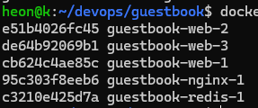

# 7주차: Docker Compose

## Docker Compose

```
독립된 컨테이너들이 함께 동작하도록 구성 및 관리하는 도구
```

## compose.yaml 구조

```
services:         # 띄울 컨테이너들
 web:             # 서비스 이름
  build: .        # Dockerfile로 빌드
  ports:
   - "8080:5000"
  environment:
   REDIS_HOST: "redis"
  depends_on:
   - redis
 redis:          # 서비스 이름 (DNS 이름으로 사용)
  image: redis:7-alpine    #이미 있는 이미지 사용. Dockerfile로 빌드하느냐 이미 있는 이미지 쓰냐.
  volumes:
   - redis-data:/data

volumes:
 redis-data: # 볼륨 선언


서비스 이름: web, redis
* 같은 네트워크에서 서비스 이름으로 접근할 수 있음.
```

```
내부 추천 순서

1. image, build  - 어떤 이미지로 실행할 것인가?
2. command       - 무엇을 실행할 것인가?
3. ports, expose - 어떤 포트를 사용할 것인가?
4. environment   - 어떤 설정값을 전달할 것인가?
5. volumes       - 어디에 파일과 데이터를 저장할 것인가?
6. depends_on    - 어떤 서비스에 의존하는가?
7. healthcheck   - 정상 상태를 어떻게 확인할 것인가?
8. restart       - 종료되었을 때 어떻게 할 것인가?
9. devlop        - 개발 중 파일 변경을 어떻게 반영할 것인가?
```


### nano Tab 공백

```
nano -ET2 compose.yaml
-E : Tab키를 공백으로 전환
-T2 : 탭 너비를 2칸으로 설정
```

## compose.yaml 실습

```
services:
 web:
   build: .
   ports:
     - "8080:5000"
   environment:
     APP_TITLE: "방명록"
     REDIS_HOST: "redis"
     REDIS_PORT: "6379"
     REDIS_PASSWORD: "devops1234"
   depends_on:
     - redis
   restart: unless-stopped # 예상치 않게 종료 시 자동 재시작
  redis:
    image: redis:7-alpine
    command: ["redis-server",
      "--requirepass", "devops1234",
      "--appendonly", "yes"]
    volumes:
      - redis-data:/data
volumes:
  redis-data:
```

```
docker compose up -d

 ✔ Image redis:7-alpine        Pulled                                                                               6.8s
 ✔ Image guestbook-web         Built                                                                                2.4s
 ✔ Network guestbook_default   Created                                                                              0.2s
 ✔ Volume guestbook_redis-data Created                                                                              0.1s
 ✔ Container guestbook-redis-1 Started                                                                              0.8s
 ✔ Container guestbook-web-1   Started   

```

```
docker compose restart web     - redis 컨테이너는 남아있기에 데이터가 남아있음.

docker compose down
docker compose up -d  -> 컨테이너, 네트워크 전부 삭제 후 다시 생성해도 데이터가 남아있음.

컨테이너를 삭제해도 별도로 생성한 볼륨은 삭제 되지 않음.

docker compose down -v # 볼륨까지 삭제
```


## 내부 접근

```
docker compose exec web sh
```

## env - 환경 변수 설정

```
echo "REDIS_PASSWORD=devops1234" > .env
echo "REDIS_PASSWORD=비밀번호" > .env.example
echo ".env" >> ~/devops/.gitignore


compose.yaml 비밀번호 자리 "${REDIS_PASSWORD}" 로 수정

${REDIS_PASSWORD:?비밀번호 설정 필요}
:?에러메시지 # 필수 값 검사, 비어있으면 error 메시지

Compose는 같은 디렉터리의 .env를 자동으로 읽어서 빈칸을 채움

.gitignore의 .env : git이 .env를 무시하여 커밋 방지
```

## healthcheck

```
compose.yaml에서 
web:
 depends_on:
  redis: # - redis에서 - 제거 후 : 추가
  condition: service_healthy
 healthcheck:
  test: ["CMD", "python", "-c",
   "import urllib.request;
   urllib.request.urlopen(
   'http://localhost:5000/readyz')"]
  interval: 5s
  timeout: 3s
  retries: 5
redis:
 healthcheck: # volumes: - redis-data.. 밑에 추가
   test: ["CMD", "redis-cli", "-a",
    "${REDIS_PASSWORD}", "ping"] # 수업용
   interval: 5s
   timeout: 3s
   retries: 5

condition: servie_healthy - 의존 서비스가 healthy 가 될떄까지 시작 보류
```

## scale

```
scale  - 컨테이너 인스턴스의 개수를 조절

docker compose up -d --scale web=3  # web컨테이너 3개 띄우기

scale-out # 컨테이너나 서버 개수 늘리기 
scale-in # 컨테이너나 서버 개수 줄이기
scale-up # CPU 메모리 등 개별 서버의 성능 높이기
scale-down # 개별 서버의 자원 줄이기

그냥 3개를 띄우려고 하면 모두 같은 포트를 쓰거나
공개된 포트가 없어서 접근할 수 없음.
```

## nginx 

```
리버스 프록시 (reverse proxy) : 클라이언트 요청을 대신 받아 내부 서버에 전달
로드 밸런싱(load balancing): 들어온 요청을 web들에게 분산
```

### nginx.conf 작성

```

server {
    listen 80;
    resolver 127.0.0.11 valid=5s;
    location / {
        set $backend http://web:5000;
        proxy_pass $backend;
    }
}

listen 80 # 컨테이너 안의 80 번에서 대기
resolver 127.0.0.11 # 도커가 컨테이너마다 주는 내부 DNS 주소
valid=5s 받은 답을 5초만 믿고 다시 물어봄 
set $backend ... # 변수에 web:5000을 저장
proxy_pass $backend # 받은 요청을 그 주소로 대신 전달 (프록시)
```

```
compose.yaml

nginx: # services: 아래 작성
 image: nginx:alpine
 ports:
  - "8080:80"
 volumes:
  - ./nginx.conf:/etc/nginx/conf.d/default.conf:ro
 depends_on:
  web:
   condition: service_healthy
web:
 build: .
 expose: # ports를 expose로 변경
  - "5000" # "8080:5000"을 "5000"으로 변경
 

```
```
docker compose up -d --scale web=3  

서로 다른 컨테이너가 응답하는 것을 볼 수 있음
```

## config 미리 검사

```
docker compose config --quiet && echo OK
docker compose config | grep requirepass -A1

config 
${...}가 다 채워진 최종 설정을 보여줌 (컨테이너 띄우기 X)
--quiet
출력 없이 검사만 진행

-A1
 검색된 줄과 아래 1줄까지 함꼐 출력
A; After (아래) B: Before(위) C: Context(위아래)

ex ) -B3: 검색된 줄 + 위로 3줄, -C2: 검색된 줄 + 위아래 각각 2줄
```

## watch 자동 반영

```
compose.yaml 에서 

web:
 devlop:
   watch:
    - action: rebuild
      path: ./app.py

./app.py가 바뀌면 rebuild : 자동으로 이미지를다시 빌드하고 해당 서비스 컨테이너를 재생성
```

```
docker compose watch --no-up  - compose up 시키지않고 이미 실행 중인 컨테이너 watch 
docker compose up --watch - compose up 시키면서 동시에 watch # Ctril + C 할시 컨테이너 종료

```

## 혼자 해보기

docker compose ps 결과
```
heon@k:~/devops/guestbook$ docker compose ps
NAME                IMAGE            COMMAND                  SERVICE   CREATED          STATUS                   PORTS
guestbook-nginx-1   nginx:alpine     "/docker-entrypoint.…"   nginx     20 minutes ago   Up 7 minutes             0.0.0.0:8080->80/tcp, [::]:8080->80/tcp
guestbook-redis-1   redis:7-alpine   "docker-entrypoint.s…"   redis     20 minutes ago   Up 7 minutes (healthy)   6379/tcp
guestbook-web-1     guestbook-web    "python app.py"          web       7 minutes ago    Up 7 minutes (healthy)   5000/tcp
guestbook-web-2     guestbook-web    "python app.py"          web       7 minutes ago    Up 7 minutes (healthy)   5000/tcp
guestbook-web-3     guestbook-web    "python app.py"          web       7 minutes ago    Up 7 minutes (healthy)   5000/tcp
```

scale 후 각 웹 컨테이너 호스트명(컨테이너ID) 결과




down 후 up과 donw -v 후 up 차이 

```
docker compose down 은 생성된 저장소까지는 삭제하지 않아 다시
docker compose up 후에 남아있는 저장소를 사용하지만

docker compose down -v은 생성된 저장소까지 다 삭제 하기 때문에
docker compose up 을 하면 새로운 저장소가 생성되어 원래 있던 데이터가 삭제된다.
```

.env를 Git에 올리지 않는 이유

```
.env에는 API키, 비밀번호 같은 민감한 정보가 포함되어 있기 때문에 
민감한 정보를 보호하고 개발환경마다 다른 설정을 안전하게 관리하기 위해서이다.

때문에 
.gitignore에 .env를 포함하여 git이 무시하도록 한다.

하지만 .env 파일이 어떤 환경변수 목록이 있는지 형식을 알려줘야 하기 때문에
.env.example 파일은 git에 올려 어떤 설정이 필요한지 알려줄수 있다.
```

