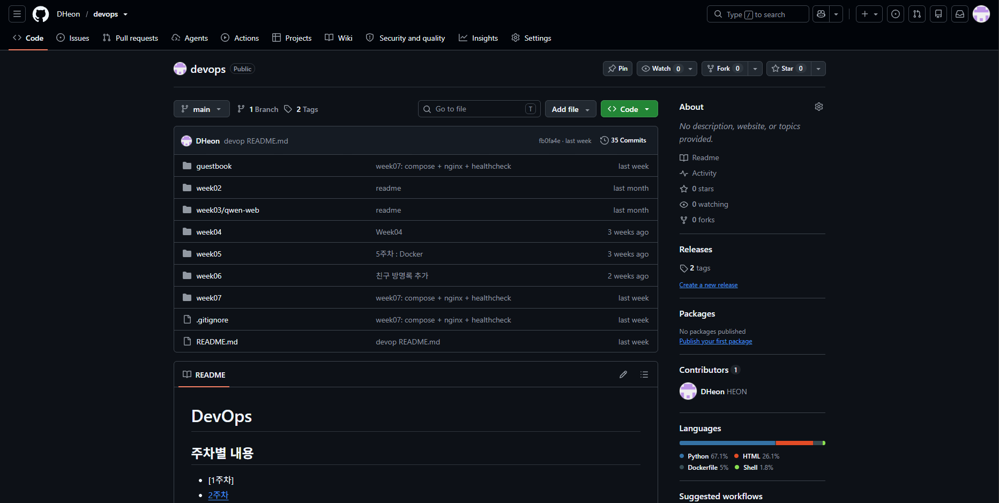
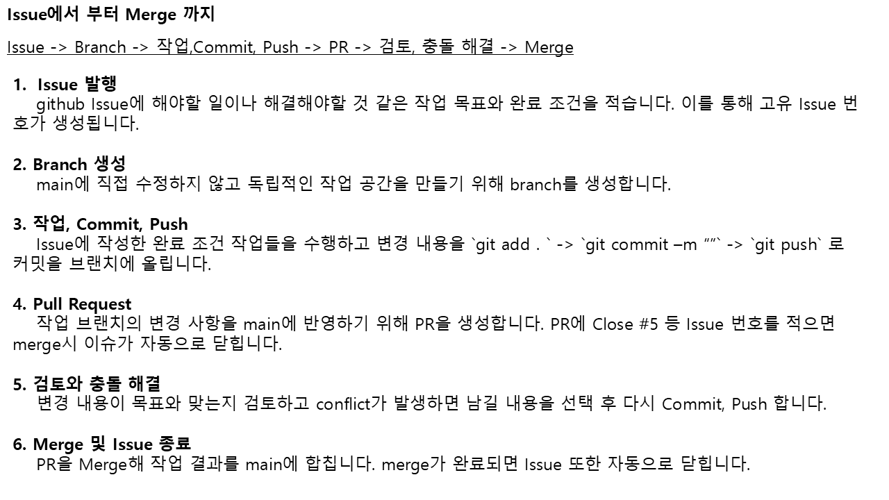

# 중간종합평가 - 202344057 김도헌

## GitHub Repository 

[Git 주소](https://github.com/DHeon/devops)



## 주차별 README.md 

- [2주차](https://github.com/DHeon/devops/blob/main/week02/README.md)
- [3주차](https://github.com/DHeon/devops/blob/main/week03/qwen-web/README.md)
- [4주차](https://github.com/DHeon/devops/blob/main/week04/README.md)
- [5주차](https://github.com/DHeon/devops/blob/main/week05/README.md)
- [6주차](https://github.com/DHeon/devops/blob/main/week06/README.md)
- [7주차](https://github.com/DHeon/devops/blob/main/week07/README.md)

## Issue에서부터 Merge까지의 과정

[ppt 파일](https://github.com/DHeon/devops/blob/main/week08/Issue_Merge.pptx)

ppt 미리보기 이미지


## web=3을 항상 유지하는 방법

셸 스크립트로 자동화

```

while true; do
    count=$(docker compose ps --status running -q web | wc -l)

    if [ "$count" -ne 3]; then 
        docker compose up -d --scale web=3
    fi

    sleep 5
done
```

```
1. 실행 중인 web 컨테이너의 ID를 조회해 wc -l로 개수를 셉니다.
2. 개수가 3이 아니면 docker compose up -d --scale web=3를 통해 다시 3개로 실행하도록 합니다.
3. 5초 후 다시 확인을 하도록 합니다.
```

### 장단점과 한계

#### 장점

```
사람이 계속 확인하지 않아도 중지되거나 삭제된 컨테이너를 다시 실행하고 생성할 수 있습니다.

셸 스크립트를 통해 원하는 만큼 실행 컨테이너 수를 조정할 수 있고 확인 간격도 조정 할 수 있습니다.
```

#### 단점

```
확인 주기에 따른 무조건적인 지연이 발생합니다. 

계속해서 실행 중인 상태이기에 자원을 계속해서 사용하게 됩니다.

컨테이너를 종료하고 싶어도 다시 실행시키므로 스크립트를 먼저 꺼줘야 합니다.
```

#### 한계

```
확인 주기와 컨테이너 실행 시간 때문에 즉시 복구는 불가능해 일시적으로 실행 컨테이너가 3개 미만이 될 수 있습니다.

터미널 종료나 서버 재부팅으로 스크립트가 종료되면 자동 복구 할 수 없습니다.

running되고 있는 컨테이너의 수만 보기에 실행되고 있는 컨테이너에 오류가 발생하거나 
unhealthy 상태에 따른 문제를 잡아내지 못합니다.
```
