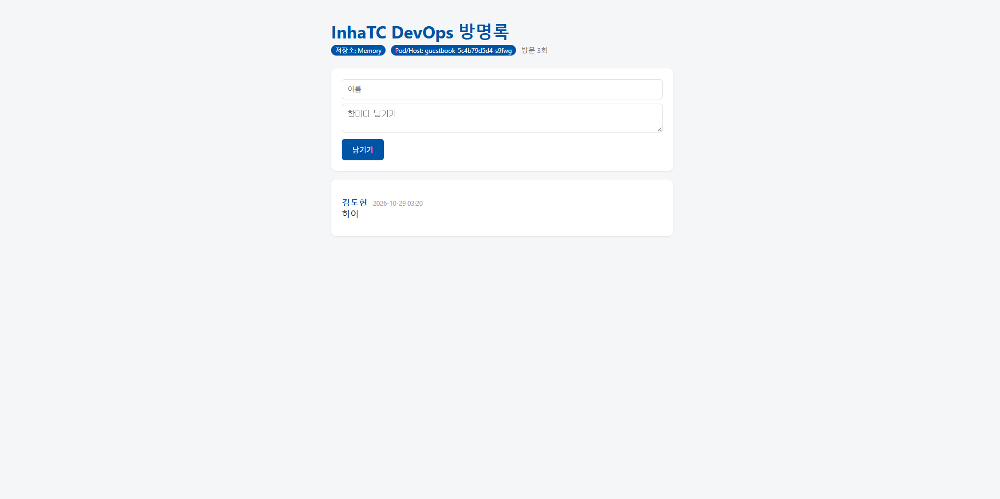

# 9주차 : 쿠버네티스

## kubectl과 minikube

```
kubectl은 리모컨

minikube는 TV

kubectl은 클러스터에게 명령을 보내고

minikube는 노드 1개의 클러스터를 만드는 도구
kind는 도커 컨테이너 안에 클러스터를 만드는 도구

kubectl이라는 리모컨과 minikube또는 kind라는 TV가 있어야함.
```

## 선언형

```
쿠버네티스는 선언형으로 상태를 선언하고 지속적으로 유지할 수 있다.

replicas: 3 

-> 쿠버네티스가 알아서 3개를 유지 

컨테이너가 죽으면?
-> 쿠버네티스가 알아서 살림

'무엇을' 원하는지만 선언
```

### 조정 루프

``` 
reconciliation loop

관찰 -> 비교 -> 조치
```


## 클러스터

```

API Server : kubectl의 요청을 받는 창구
etcd : 클러스터의 모든 상태를 기록
Scheduler : 새 Pod를 어느 노드에 둘지 기록
Controller : 원하는 상태와 현재를 비교해 맞춘다
Node : 실제로 컨테이너가 도는 서버
kubelet : Pod를 실제로 띄움
Pod : 컨테이너를 감싼 최소 단위
```

## 클러스터 탐색

```
kubectl get nodes -o wide
kubectl cluster-info
kubectl get pods -A

kubectl config current-context # 어느 클러스터를 보고 잇는지 체크

```

## 첫 Pod

```
$ kubectl run mynginx --image=nginx
pod/mynginx created

$ kubectl get pods
NAME      READY   STATUS    RESTARTS   AGE
mynginx   1/1     Running   0          32s

$ kubectl get pods -w 로 관찰 가능
```

```
$ kubectl describe pod mynginx # 상세정보

$ kubectl logs mynginx # 로그 보기

$ kubectl exec -it mynginx -- bash # 들어가기
```

### 포트 연결
```
kubectl port-forward mynginx 8080:80

내 노트북의 8080 포트와 Pod의 80 포트를 연결함
```

### 포드 삭제

```
$ kubectl delete pod mynginx
```


## Deployment 의 Pod

```
내부 컨테이너 비정상 종료 - 재시작 가능
Pod자체를 삭제-> 새로운 Pod생성
복제본 개수 유지 -> 가능
```

Deployment를 사용해서 mynginx pod가 3개가 되게 선언

```
$ kubectl create deployment mynginx --image=nginx --replicas=3


$ kubectl get pods

NAME                       READY   STATUS    RESTARTS   AGE
mynginx-668c4f948b-9hsgg   1/1     Running   0          49s
mynginx-668c4f948b-h7h6h   1/1     Running   0          49s
mynginx-668c4f948b-pjbmr   1/1     Running   0          49s
```

scale

```
$ kubectl scale deployment mynginx --replicas=5

$ kubectl get pods # 5개 

$ kubectl scale deployment mynginx --replicas=2
$ kubectl get pods # 2개  3개가 정리되게됨
```

삭제

```
kubectl delete deployment mynginx
```


오류 상태의 pod를 새로 생성하도록 요청

```
$ kubectl delete pod -l app=guestbook

-l : 레이블을 통해 pod선택
```

```
레이블
app=guestbook은 create deployment가 이름을 따서 자동으로 설정함
```

```
$ kubectl delete pod -l app= 
을 통해 다시 실행을 해도 브라우저 접속은 복구 되지 않음

Deployment는 Pod를 유지하고 
Pod에 접근할 수 있는 안정적인 네트워크 경로를 제공하는 Service는 복구되지 않음
```


## 혼자 해보기

### kubectl get nodes 결과

```
heon@k:~/devops$ kubectl get nodes
NAME       STATUS   ROLES           AGE    VERSION
minikube   Ready    control-plane   104m   v1.37.0
```

### pod 생성과 삭제 그리고 복구 

```
$ kubectl create deployment guestbook --image=ghcr.io/dheon/guestbook:v1 --replicas=3
deployment.apps/guestbook created

$ kubectl get pod
NAME                         READY   STATUS    RESTARTS   AGE
guestbook-5c4b79d5d4-d7v46   1/1     Running   0          15s
guestbook-5c4b79d5d4-s9fwg   1/1     Running   0          15s
guestbook-5c4b79d5d4-wbwkv   1/1     Running   0          15s

$ kubectl delete pod guestbook-5c4b79d5d4-d7v46
pod "guestbook-5c4b79d5d4-d7v46" deleted from default namespace
```

get pods -w 출력 

```
$ kubectl get pod -w
NAME                         READY   STATUS    RESTARTS   AGE
guestbook-5c4b79d5d4-d7v46   1/1     Running   0          31s
guestbook-5c4b79d5d4-s9fwg   1/1     Running   0          31s
guestbook-5c4b79d5d4-wbwkv   1/1     Running   0          31s
guestbook-5c4b79d5d4-d7v46   1/1     Terminating   0          55s
guestbook-5c4b79d5d4-sg7gl   0/1     Pending       0          0s
guestbook-5c4b79d5d4-d7v46   1/1     Terminating   0          55s
guestbook-5c4b79d5d4-sg7gl   0/1     Pending       0          0s
guestbook-5c4b79d5d4-sg7gl   0/1     ContainerCreating   0          0s
guestbook-5c4b79d5d4-sg7gl   0/1     ContainerCreating   0          1s
guestbook-5c4b79d5d4-sg7gl   1/1     Running             0          1s
guestbook-5c4b79d5d4-d7v46   0/1     Error               0          84s
guestbook-5c4b79d5d4-d7v46   0/1     Error               0          84s
guestbook-5c4b79d5d4-d7v46   0/1     Error               0          84s
```

### 쿠버네티스 브라우저 화면

```
$ kubectl port-forward deployment/guestbook 8080:5000
Forwarding from 127.0.0.1:8080 -> 5000
Forwarding from [::1]:8080 -> 5000
를 통해 port를 연결
```



### 선언형에 대해

```

명령형은 행동을 직접 지시하는 것

EX)
도우를 반죽하라.
토마토소스를 발라라.
치즈를 올려라.
오븐에서 15분 구워라.

선언형은 무엇을 원하는 지 선언하는 것
EX)
페퍼로니 피자 하나 주세요.

