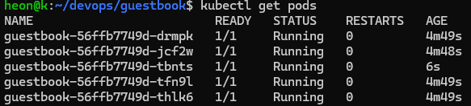
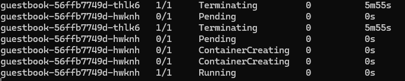

# Week10 : 쿠버네티스 배포와 서비스

## YAML 

```
apiVersion: apps/v1
kind: Deployment
metadata:
  name: guestbook
spec:
  replicas: 2
  selector:
    matchLabels:
      app: guestbook
  templates:
    metadata:
      labels:
        app: guestbook
    spec:
      containers:
        - name: web
          image: ghcr.io/[ID]/guestbook:v1
          ports:
            - containerPort: 5000
```

```
이 yaml의 해석은 즉 deployment를 만드는데 replica는 2개로 유지하고 레이블은 app: guestbook,
이 deployment에 넣을 pod의 templates을 넣어주는데
pod의 label은 app: guestbook이고 안에 있을 컨테이너로 web이라는 이름의 image: 이미지를 가진 5000포트의 
pod를 deployment에 넣어주겠다는 소리
```

```
apiVersion: apps/v1  # 1. API 버전
kind: Deployment     # 2. 무엇을 할 것 인가
metadata:            # 3. 이름표
spec:                # 4. 원하는 상태
```

```
selector.matchLabels = template.metadata.labels
```

### apiVersion 확인 법

```
$ kubectl api-resources | grep -E "^deployments|^services"
```

### template
```
template = 붕어빵 틀(Pod 설계도)
Pod = 틀에서 찍어낸 붕어빵
```

### label, selector

```
label : IP, 이름을 몰라도 레이블만으로도 찾을 수 있음.

selector : 레이블로 골라내는 조건
```


### Serivce

Pod가 죽었다가 살아나면 IP 주소가 바뀌기에
Service의 고정된 이름과 고정된 IP로 접속하게 함.

### 포트

Node Port: 외부에 노출되는 포트
Serivce Port : 서비스의 포트 
Pod's Container's Port : 컨테이너의 포트, Pod 내부 애플리케이션이 요청을 받을 포트

## 실행 전 검사

```
$ kubectl apply -f k8s/deployment.yaml --dry-run=server
```

## 배포

```
$ kubectl apply -f k8s/deployment.yaml
```

```
$ kubectl get all   # 상태 한눈에 보기 가능
```

```
kubectl delete -f k8s/    # 삭제
```

## 레이블 확인 방법
```
$ kubectl get pods --show-labels
```

## service.yaml 작성

```
apiVersion: v1
kind: Service
metadata:
  name: guestbook
spec:
  type: NodePort
  selector:
    app: guestbook
  ports:
    - port: 80
      targetPort: 5000
      nodePort: 30080
```

selector를 통해 해당 레이블의 Pod들에게 분배

port: 80 : 서비스 포트 
targetPort: 5000 : Pod (컨테이너) 포트
nodePort: 30080: 외부 접속 포트

### service.yaml 적용

``` 
$ kubectl apply -f k8s/service.yaml

$ kubectl get svc

$ kubectl describe svc guestbook
```

## 접속

```
$ minikube service guestbook
```

## 스케일링 + 로드밸런싱

```
$ kubectl scale deployment guestbook(deployment이름) --replicas=4
```

터미널에서 서비스 응답 확인
```
$ kubectl run lb-check --rm -i --restart=Never --image=busybox:1.37 -- \
sh -c 'for i in 1 2 3 4 5 6 7 8 9 10; do wget -q -T 3 -O- http://guestbook/healthz; echo; done'
```

```
$ kubectl scale 방식은 바로 바꿀 수 있지만 

deployment.yaml을 수정하는 방식은 기록을 남긴다.

다시 apply를 하면 deployment.yaml을 기준으로 맞춘다.
```

## 혼자 해보기

replicas를 5로 늘리고 kubectl get pods 결과


Pod 하나 삭제 후 확인


