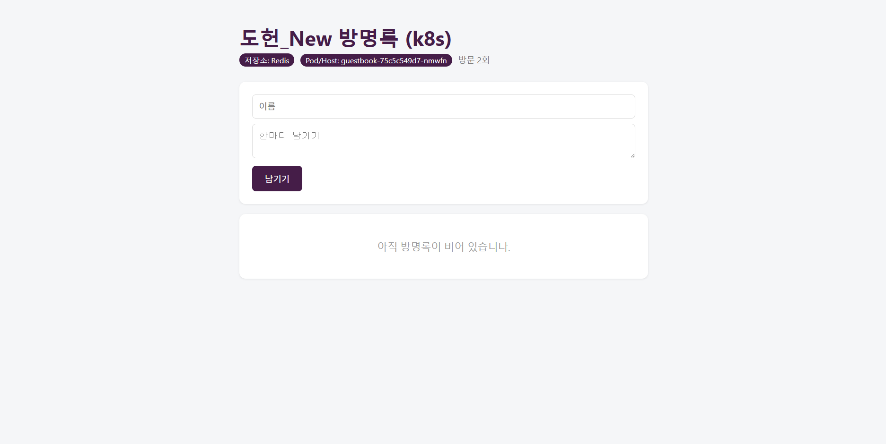

# Week 11 : Configmap, Secret, Probe


## 무상태

```
설정은 ConfigMap/Secret에서 받아오고
데이터는 DB (Redis)에 저장
로그는 표준 출력으로 보낸다.

-> 무상태
여러 Pod로 복제해도 일관된 서비스를 제공하기 쉽다.
```

## base64

```
$ echo -n devops1234 | base64
ZGV2b3BzMTIzNA==  #base64로 인코딩 됨

$echo ZGV2b3BzMTIz== | base64 -d
devops1234        #base64 디코딩됨
```

## ConfigMap, Secret 작성

ConfigMap
```
apiVersion: v1
kind: ConfigMap
metadata:
  name: guestbook-config
data:
  APP_TITLE: "방명록(k8s)"
  THEME_COLOR: "#16a34a"
  REDIS_HOST: "redis"
  REDIS_PORT: "6379"
```

Secret
```
apiVersion: v1
kind: Secret
metadata:
  name: guestbook-secret
type: Opaque
stringData:
  REDIS_PASSWORD: "devops1234"
```

```
stringData: 평문으로 작성한 값은 Secret의 data로 변환되어 base64형태로 표현된다
```


```
$$ kubectl apply -f k8s/configmap.yaml
$ kubectl apply -f k8s/secret.yaml
$ kubectl get cm,secret
```


Redis 배포
```
apiVersion: apps/v1
kind: Deployment
metadata:
  name: redis
spec:
  replicas: 1
  selector:
    matchLabels:
      app: redis
  template:
    metadata:
      labels:
        app: redis
    spec:
      containers:
        - name: redis
          image: redis:7-alpine
          args:
            - redis-server
            - --requirepass
            - $(REDIS_PASSWORD)
          env:
            - name: REDIS_PASSWORD
              valueFrom:
                secretKeyRef:
                  name: guestbook-secret
                  key: REDIS_PASSWORD
          ports:
            - containerPort: 6379
---
apiVersion: v1
kind: Service
metadata:
  name: redis
spec:
  type: ClusterIP
  selector:
    app: redis
  ports:
    - port: 6379
      targetPort: 6379
```

Deployment에 주입

```
envFrom:
  -configMapRef:
     name: guestbook-config
  -secretRef:
     name: guestbook-secret

resources:
  requests:
    memory: "64Mi"
    cpu: "100m" 
  limits:
    memory: "128Mi"
    cpu: "500m"
```

```
kubectl apply -f k8s/deployment.yaml
kubectl apply -f k8s/redis.yaml
```


## 설정만 변경

```
$ kubectl edit configmap guestbook-config

$ kubectl rollout restart deployment guetstbook
```

```
ConfigMap을 수정해도 이미 떠 있는 Pod는 모르기에
restart를 통해 새 값을 읽게 해야한다,
```

## 헬스체크

```
앱은 살아있지만 응답을 못하는 상태

프로세스는 살아있기 때문에 쿠버네티스는 정상으로 판단하지만 
실제로는 정상적인 서비스가 아님

->
쿠버네티스가 주기적으로 앱의 응답 통로를 통해 물어보게 함.

/healthz, /readyz

```


## 혼자 해보기

### base64


```
base64 인코딩은 암호화가 아니라 단순 인코딩이기 때문에
base64 -d 명령어 만으로 바로 디코딩하여 쉽게 원래의 문자열을 알아내는 것이 가능하다.
```

### ConfigMap으로 제목과 Theme 변경

